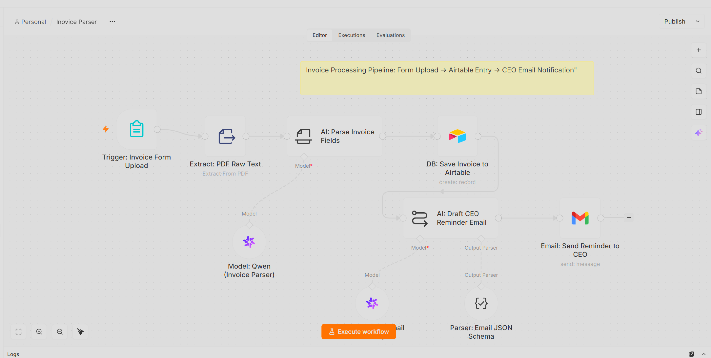
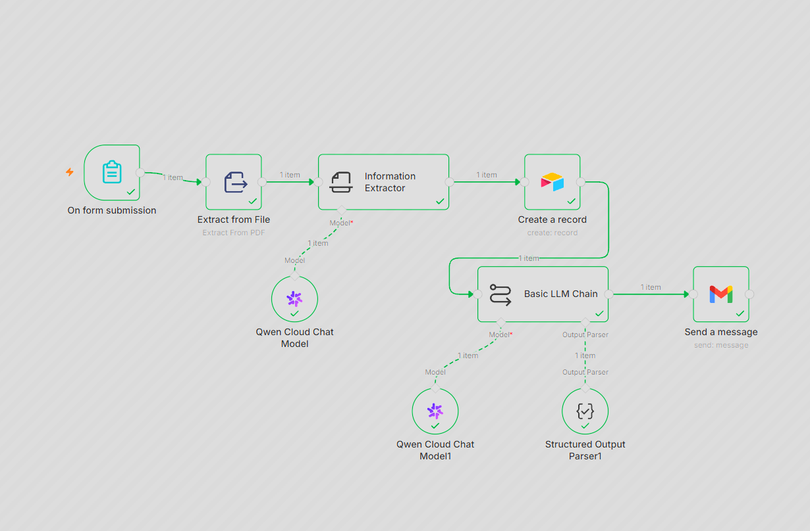

# 📄 AI Invoice Processing Pipeline: Automated PDF Extraction & CRM Sync

An enterprise-grade, 100% autonomous financial document automation pipeline orchestrated in **n8n**. This pipeline completely eliminates manual invoice data entry by leveraging **Alibaba Cloud Qwen LLMs** for intelligent text parsing, **Airtable** for CRM record management, and automated **Gmail** reminders for executive oversight.

---

## 🌟 Executive Summary
Designed to streamline financial operations for growing businesses. When a vendor uploads a PDF invoice through a secure n8n form interface, the system automatically extracts raw text, uses advanced LLM information extraction to pull line-items and financial data, logs the entry into an Airtable CRM database, drafts a professional payment reminder email using AI, and securely dispatches it to company leadership. The entire workflow runs efficiently on a **self-hosted Docker infrastructure**, ensuring complete data privacy and zero dependency on expensive third-party SaaS platforms.

---

## 🖼️ System Architecture & Execution Proofs

### 1. Core n8n Workflow Architecture
*The complete orchestration canvas showing Form Trigger, PDF text extraction, Qwen LLM parser, Airtable CRM node, and automated Gmail dispatch:*

### 2. Successful Pipeline Execution
*Live execution logs showing successful data flow, green ticks across all nodes, and verified payload processing:*

---

## ⚙️ Core Tech Stack & AI Models

### 1. Infrastructure & Orchestration
- **Engine:** n8n (Self-Hosted via Docker on Local Environment)
- **Data Capture:** n8n Native Form Trigger (Secure web-based file upload interface)
- **Database / CRM:** Airtable API (Automated record creation and tracking)

### 2. AI Generation & Parsing Models
- **Information Extractor:** n8n LangChain Information Extractor Node
- **LLM Brain:** Alibaba Cloud Qwen (`qwen3-vl-plus`) for intelligent structural data mapping.
- **Email Drafter:** Advanced LangChain LLM Chain paired with structured output parsing to generate executive-ready JSON schemas.

### 3. Communication Layer
- **Email Dispatch:** Gmail API (OAuth2 secure authentication for automated reminder deployment)

---

## 🚀 The Automated Pipeline Flow

1. **Form Ingestion:** Users upload a PDF invoice via the secure web form interface.
2. **Text Extraction:** The `Extract From PDF` node pulls raw, unstructured text from the document binary data.
3. **AI Information Parsing:** Qwen LLM analyzes the text to accurately extract precise fields:
   - Invoice Number & Date
   - Sender Name, Address, & Email
   - Customer Phone Number
   - Total Amount & Due Date
4. **CRM Synchronization:** The extracted data is automatically structured and pushed into Airtable (`Invoice Detail` table).
5. **AI Email Generation:** A secondary LLM chain crafts a formal, polite, and executive-ready payment reminder email addressed to the CEO.
6. **Automated Notification:** The final JSON payload is parsed and dispatched via Gmail to company leadership.

---

## 👨‍💻 Engineering Highlights & Problem Solving

- **Dockerized Local Deployment:** Hosted completely on a self-hosted local Docker container, ensuring high-speed local network execution and absolute confidentiality of sensitive financial invoices.
- **Structured JSON Schema Parsing:** Implemented strict LangChain output parsers to convert free-form LLM email responses into rigid JSON structures (`subject` and `body`), preventing downstream execution failures in the Gmail node.
- **Robust Field Mapping:** Configured fallback handling and dynamic regex mapping inside the information extractor to accurately catch varying invoice layouts and currency formats.

---
*Architected and Developed by **Abu Bakar Siddique** (@hafiz-abubakar-dev) — AI Automation Engineer*
